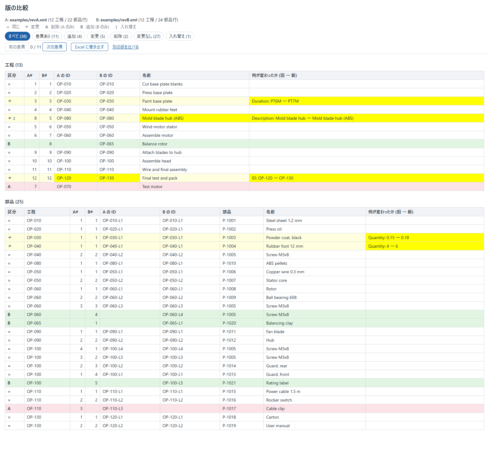
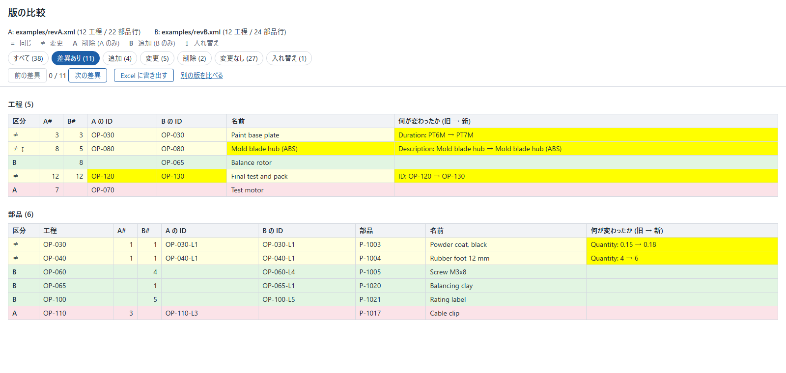

# mfg-revision-diff

Compares two revisions of a manufacturing process plan together with the material bill under each step, and sorts every step and every bill row into **same, changed (old → new), added, removed or moved**. You give it two B2MML (ISA-95 XML) files, it shows the result on a local web page with filters and "previous / next difference" buttons, and writes it to an Excel workbook. It is meant for process planners and manufacturing engineers who need to see what changed between two revisions without a paid PLM or ERP module.

The Business To Manufacturing Markup Language (B2MML) is used courtesy of MESA International.

All example data is fictional (a made-up company and product). The screen is in Japanese; this document and the code are in English.






## What already exists, and how this differs

**Paid PLM and ERP products** have a revision compare: SAP S/4HANA (routing comparison with the symbols `=` `≠` `A` `B` and Previous / Next buttons), Oracle Fusion Product Development (filters All / Differences / Added / Changes / Removed / Unchanged, yellow cells, Excel output), PTC Windchill (Previous / Next difference, "Export list to file") and OpenBOM (a change report as an Excel file). Public prices: OpenBOM lists its Company plan, the plan that carries its change management, at $90 per seat and month billed yearly ($165 billed monthly) [openbom.com/pricing](https://www.openbom.com/pricing); no public price was found for SAP, Oracle or Windchill. This tool takes the symbols, the filter names, the buttons, the yellow cells and the Excel export from those pages (`docs/sources.md` S4.6, S4.7, S11.10a to S11.10e) and runs on a PC without any of them.

**Free open-source tools** that compare bills of material exist: the ERPNext BOM Comparison Tool (GPL-3.0; part and operation as the key, rows with the same key paired in order of appearance), InvenTree's BOM compare (MIT; part ID as the key, result sorted by name), aras-bom-compare (MIT; part number or sort order as the key) and ttran-tech/bom-diff (MIT, for Oracle Agile). In the pages and code that were read, none reports a step that has the same content and a new position as a category of its own.

What is different here:

- It compares the **steps of a process plan and their bills together**, from a vendor-neutral file format (B2MML).
- The pairing of old and new rows does not trust IDs: it survives renumbered steps, renamed steps, reordered steps and the same part appearing in several rows (`docs/adr/0001-matching.md`), and its accuracy is measured (see below).
- **Moved** is its own category, because the order of steps has meaning in a process plan.

## Technology

- Java 17, Maven; package `dev.mfgdiff`.
- B2MML 0701 schema files (MESA, bundled unchanged, commit `65cc665`); XML read and schema-validated with the JDK's `javax.xml`, with DOCTYPE and external entities refused.
- Matching: the structure of [xmldiff](https://github.com/Shoobx/xmldiff) (MIT) written again in Java (unique key, similarity threshold, longest common subsequence for moves), with a port of Python's `difflib` ratio (PSF); `NOTICE` lists the sources.
- Screen: the JDK's `com.sun.net.httpserver` on 127.0.0.1 (`docs/adr/0003-screen-base-jdk-httpserver.md`).
- Excel: Apache POI 5.5.1 (`poi-ooxml`), with `log4j-api` pinned to 2.25.5 (`docs/adr/0004-excel-export-poi.md`). No other runtime library.
- Tests: JUnit 5.10.2. 101 tests.

## Run it

Needs a JDK 17 or later and Maven 3.9.

```
mvn test                  # compiles, runs the 101 tests; the first run downloads POI into ~/.m2
powershell -ExecutionPolicy Bypass -File scripts\run.ps1   # Windows   (optional: -Port 8081)
scripts/run.sh            # Linux, macOS, Git Bash   (optional: ./scripts/run.sh 8081)
```

On Windows the script is started with `-ExecutionPolicy Bypass` because the default policy of Windows client computers, Restricted, "doesn't allow scripts"; the parameter applies to that one PowerShell process only and changes no setting (`docs/sources.md` S11.14). Then open <http://127.0.0.1:8080/>. Press **見本で試す** to compare the sample revisions, or choose two B2MML files. Stop the server with Ctrl+C. Offline, use `mvn -o test`.

The scripts start the compiled classes (`target/classes`) with a class path made from the 13 jars in `~/.m2` (listed at the top of each script); no plugin that bundles the libraries into one jar is part of the build. `ProjectFilesTest` checks that the scripts and the pom agree.

The text report still works without the screen:

```
java -cp target/classes dev.mfgdiff.Cli examples/revA.xml examples/revB.xml [--filter Differences] [--validate] [--f 0.7] [--ratio fast|accurate]
```

## Example: the two sample revisions

`examples/revA.xml` and `examples/revB.xml` hold 12 steps each (22 and 24 bill rows). Press **見本で試す** (or run the command above) and you get:

| | same | changed | added | removed | moved |
|---|---:|---:|---:|---:|---:|
| steps | 8 | 3 | 1 | 1 | 1 |
| bill rows | 19 | 2 | 3 | 1 | – |

- OP-030 changed: `Duration: PT6M → PT7M`.
- OP-080 changed and moved: its description changed and it now stands before OP-050.
- OP-120 was renumbered to OP-130: the ID cells are yellow, nothing else changed.
- OP-065 is new, OP-070 is gone. OP-100 lists the same bill rows in another order and has one new row: only the new row is a difference.
- Bill rows: two quantities changed (`0.15 → 0.18`, `4 → 6`), a second screw row appeared in OP-060 (the same part twice is not hidden), a label was added to OP-100, a cable clip was removed from OP-110.
- The seven filters give 38 (all), 11 (differences), 4 (added), 5 (changes), 2 (removed), 27 (unchanged) and 1 (moved) rows; the buttons **前の差異** / **次の差異** step through the 11 differences in order.
- **Excel に書き出す** downloads `mfg-revision-diff.xlsx` with three sheets: まとめ (files, setting, counts, colour legend), 工程 (13 step rows) and 部品 (25 bill rows). Changed rows are light yellow, the cells that changed are yellow, the header row is frozen and has filter arrows. Every cell that holds text from an input file is a text cell; a name such as `=1+1` stays text.

## Why it was built, how, and what came out

**Why.** Without a compare function, two revisions are compared by opening both and reading them side by side; SAP's own support page on BOM comparison calls that "opening up the BOM’s in two different sessions would be cumbersome" (`docs/sources.md` S4.8). The paid products show a compare view, but they cost money and are tied to their own data; the free tools that exist compare part lists by part number and do not treat the order of steps as a change. I wanted a free tool that answers "which step is which?" when numbers, names and order all changed between revisions.

**How.** The data shape is B2MML, an open XML format with schemas for process segments and material bills (ADR 0002). The pairing of rows is the hard part: a key alone fails when IDs are reused or renumbered, text similarity alone fails on near-identical steps, a tree edit distance has no "move". The tool pairs by a unique key first, then by similarity combined with the share of matched bill rows, then finds moved steps with a longest common subsequence (ADR 0001, six candidates compared). No public sample has two revisions of one plan, so a change generator makes the second revision from the first and records the truth, and the tool is scored against it per category (precision and recall, `docs/validation/`). Failures of other tools became tests: duplicate part rows, reordered rows, duplicate step IDs. The screen and the Excel file are described in ADR 0003 to 0005.

**Result** (`docs/validation/results.md`; invented data, 30 steps per revision, the setting chosen on seeds 1 to 20 and reported on seeds 21 to 40):

- With 5 % of the nodes changed, all 20 held-out runs reproduced the applied changes exactly in every category (127 operations). At 10 % and 20 %, 19 of 20 runs were exact (257 and 513 operations).
- Over all held-out runs there were 4 segment-level errors with the chosen setting (similarity threshold F = 0.7) against 88 with xmldiff's own default of 0.5.
- The remaining differences are listed in `results.md`: for example, a removed step and an added step that look alike are paired as one changed step in one run (10 %, seed 37).
- 101 tests pass. Breaking the code on purpose in nine places (six in the matching, `docs/validation/mutation-check.md`; the output encoding, the origin check and the Excel colour) made the tests fail each time.
- The numbers come from generated data and a generator written for this project, so they describe the matching on that kind of change.

## Out of scope

| not covered | why |
|---|---|
| Nested steps (a step inside a step) | The tool compares the flat list of `OperationsSegment` and lists any nested element as a warning; comparing trees of steps needs a second matching level (`docs/sources.md` D5). |
| Multi-level bills (a bill item that has its own bill) | The tool compares one bill level per step and reads the part number from `MaterialSpecificationID`; deeper levels are listed as a warning (D1, D5). |
| Dependencies between steps (`SegmentDependency`) | The tool orders steps by their `Indice` parameter or by document order and lists the dependencies as a warning (D3, D5). |
| Formats other than B2MML (a PLM's or ERP's own export) | The tool reads B2MML only; another format needs a converter to B2MML or a second reader that fills the same model (`Definition`, `Node`). |

## Fitting it to another plant's data

What differs from one plant's B2MML export to the next, and where the tool decides it:

| what can differ | where it is set | default |
|---|---|---|
| The element that holds the part number of a bill row | `Node.key()` (`Node.java` L51-L53) and `B2mmlReader.ITEM_SIMPLE` (`B2mmlReader.java` L31-L32), D1 | `MaterialSpecificationID` |
| Where the position of a step is kept | `B2mmlReader.ORDER_PARAMETER` (L26, D3); without it, document order | `Indice` |
| Which fields count as a change | `B2mmlReader.SEG_SIMPLE` and `ITEM_SIMPLE` (L28-L32, D4); every other element is listed under 比べていない要素 on the screen and on the まとめ sheet | 12 step fields and the step's parameters; 7 bill-row fields and the quantity |
| How different a step may become and still be the same step | `--f` and `--ratio` on the command line; `NodeMatcher.DEFAULT_F` and `DEFAULT_MODE` (`NodeMatcher.java` L23-L24) for the screen | F = 0.7, fast |
| Largest input file | `SecureXml.MAX_BYTES`, `MAX_DEPTH`, `MAX_ELEMENTS` (`SecureXml.java` L31-L35, D11) | 8 MiB, depth 64, 200,000 elements |

The threshold is the setting most likely to need a change: it was chosen on invented step names (ADR 0001, Consequences). `ChangeGenerator.generate` takes any `Definition` as the first revision, so the measurement of `EvalMain` (which uses `SampleData.base`, `EvalMain.java` L57-L58) can be repeated on a plant's own revision read with `B2mmlReader`.

## FAQ

**What is `log4j2.component.properties` for?** POI uses `log4j-api`, which looks for a logging implementation; with none on the class path Log4j prints `main ERROR Log4j API could not find a logging provider.` The file `src/main/resources/log4j2.component.properties` selects the Simple Logger that is part of `log4j-api`, as the Log4j manual describes, so the line does not appear and no library is added (`docs/sources.md` S11.9).

**Why is the screen only reachable from my own PC?** It listens on 127.0.0.1, refuses requests whose `Host` is another name, and accepts an upload only from its own pages (ADR 0005).

**Why two scripts instead of a jar?** The libraries are not bundled (no shade or assembly plugin is used), so a plain jar could not start the screen alone; the scripts in `scripts/` build the class path from `~/.m2` and start the classes.

## How it was checked

- `mvn -o test`: 101 tests (64 for the data shape, the matching, the generator and the readers; 37 for the screen, the Excel file and the scripts).
- The screen was started with `scripts/run.ps1` and with `scripts/run.sh` and driven in Microsoft Edge: the sample gives the five categories, each of the seven filters shows its rows (38, 11, 4, 5, 2, 27, 1), **次の差異** and **前の差異** move through the 11 differences, the Excel download opens and reads back with POI (3 sheets, no formula cell). The browser reported no console error.
- The Excel file was read back with Apache POI.
- Dependencies: OSV reports no vulnerability for `poi-ooxml` 5.5.1 and its 12 compile dependencies with `log4j-api` at 2.25.5; it reports GHSA-qv9r-c865-cp47 for the 2.24.3 that POI would bring (`docs/sources.md` S11.13, S11.13b). It reports none for the 8 test-side libraries (JUnit 5.10.2, what JUnit needs, the Surefire JUnit provider) and the 3 Maven plugins of the pom (S11.13c).
- Every quote in `docs/sources.md` was checked to be a substring of the saved copy of its source.

## Documents

- `docs/adr/0001-matching.md`, `0002-data-shape-b2mml.md`, `0003-screen-base-jdk-httpserver.md`, `0004-excel-export-poi.md`, `0005-screen-and-upload-protection.md`
- `docs/sources.md`: every rule and value with its source and quote; the author's decisions that have none; what was searched and not found
- `docs/validation/`: metrics, results, mutation checks
- `NOTICE`: third-party attributions and licences; `LICENSE`: MIT
